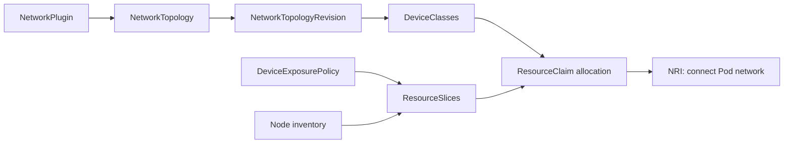

# dra-multi-network

Secondary Pod networks using Kubernetes Dynamic Resource Allocation (DRA) and
Node Resource Interface (NRI). Repository: `github.com/SchSeba/dra-multi-network`.

Cluster administrators describe approved devices and network topologies with
CRDs. The controller compiles a topology into an immutable revision and a
DeviceClass for each allocation root. Node agents publish policy-approved device
personas in ResourceSlices. Users request those classes through a ResourceClaim;
NRI connects the allocated network before application containers start.



The first POC includes internal `host-cni`, `sriov-cni`, `bond-cni`, `vlan-cni`,
`macvlan-cni`, `ipvlan-cni`, `tuning-cni`, `accelerated-bridge-cni`, `ovs-cni`, `ipam` and
`address-cni` planners.
The current POC owns discovery, allocation, native execution and recovery in the
framework; internal planners use a separate serializable contract. The production
target moves plugin-specific validation/planning **and native network execution**
to external gRPC plugins so vendors can add behavior without core handlers. Core
DRA, policy and lifecycle coordination remain shared. The execution RPC and
durable recovery boundary are future work; the existing SDK is planning-only.
MVP uses Go calls and does not invoke CNI binaries.

Implemented profiles cover exclusive host/VF interfaces, two VFs → active-backup
bond → multiple VLANs, shared macvlan/ipvlan, VF settings, VFIO, approved driver
rebinding/reset, single-port RDMA/InfiniBand and switchdev representors. Validation
checks plugin configuration and composition before publishing a revision.
Physical ownership prevents conflicting PF/VF or handoff/shared allocations.
See [validation and POC limits](docs/validation.md) before choosing a profile.

## Try it

Use Kubernetes 1.37, Go 1.27 for source builds, and an NRI-enabled runtime. Enable
`DynamicResourceAllocation`, `DRAPartitionableDevices`, `DRAConsumableCapacity`
and `DRADeviceCompatibilityGroups`. The primary CNI supplies the normal Pod network.

Follow [installation](docs/installation.md), then start with
[one VF](examples/single-vf/README.md). Each example explains prerequisites,
commands, expected results and cleanup. Hardware selectors are lab values:
edit them for a dedicated secondary device on your nodes.

```bash
# After installing the driver and adapting the PCI selectors:
./examples/single-vf/apply.sh
kubectl -n multi-network-example exec single-vf -- ip -d link show secondary0
```

For the full composition example:

```bash
./examples/bond-vlan/apply.sh
./test/integration/bond-vlan/test-traffic.sh
```

For switchdev, use the two documented [accelerated-bridge](examples/switchdev/accelerated-bridge/README.md)
and [OVS](examples/switchdev/ovs/README.md) examples. Each connects two Pods with
native VLAN 100 and tagged VLANs 200/300. The [shared setup](examples/switchdev/README.md)
explains running both together; [validation](docs/validation.md) records live mock
traffic, restart, cleanup, eswitch transitions and OVS TC offload results.

For DRA-backed address allocation, use the [macvlan IPAM example](examples/ipam/README.md)
or [two VFs with two IP addresses](examples/ipam/two-vf/README.md). The
[IPAM design](docs/ipam-plan.md) explains subnet capacity and lease ownership;
the [end-to-end checks](test/integration/ipam/README.md) cover traffic, exhaustion,
reuse, restart and cleanup.

## Documentation

| Reader | Start here |
|---|---|
| Cluster administrator | [Installation](docs/installation.md), [NetworkPlugin](docs/admin/networkplugins.md), [topologies](docs/admin/topologies.md), [exposure policies](docs/admin/exposure-policies.md) |
| Administrator debugging allocation | [CRDs → DeviceClasses and ResourceSlices](docs/admin/resource-translation.md), [operations](docs/operations.md) |
| Application user | [Connect a Pod](docs/user/pods.md), [examples](examples/README.md) |
| Contributor | [Architecture](docs/architecture.md), [development](docs/development.md), [API reference](docs/api-reference.md), [plugin boundary](pkg/pluginapi/README.md) |
| Network plugin owner | [Production gRPC design and deployment examples](docs/grpc-plugins.md) |
| IPAM developer | [IPAM design](docs/ipam-plan.md), [provider interface](pkg/ipam/provider.go), [provider tests](pkg/ipam/provider_test.go) |
| POC reviewer | [Validation](docs/validation.md), [remaining work](docs/roadmap.md) |

Configuration uses the five official project CRDs under
`networking.dra-multi-network.schseba.github.io/v1alpha1`; it does not use
ConfigMaps for plugin/topology/device policy configuration. Kubernetes
DeviceClass, ResourceSlice, ResourceClaim and ResourceClaimTemplate remain native
`resource.k8s.io/v1` objects.
