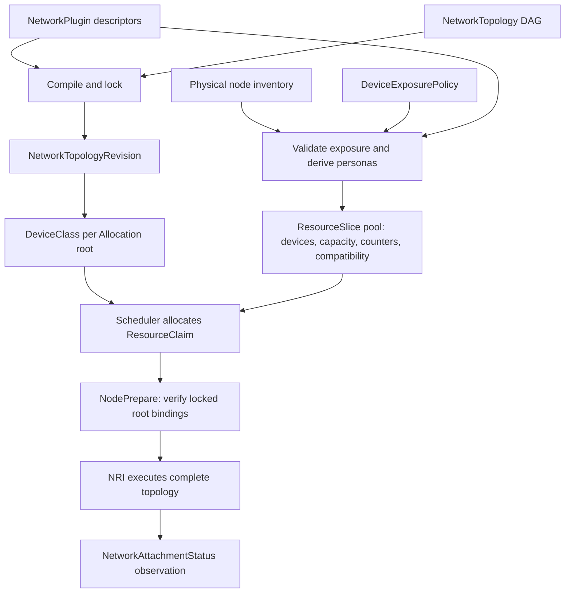

# CRDs → DeviceClasses and ResourceSlices

There are two separate translations. The controller publishes **what a workload
must request** as DeviceClasses. Each node publishes **what it can allocate** as
ResourceSlices. Kubernetes joins them while allocating a ResourceClaim.
ResourceSlice is the native DRA object name; there is no project “release slice”
CRD. Release updates ownership and subsequent slice publication.



## 1. Plugin and topology to immutable revision

The controller validates descriptor schemas and topology composition, normalizes
the contract and computes its digest. It creates a NetworkTopologyRevision
containing source topology UID, digest, compiler version, complete topology,
locked plugin names/specs/digests and dependency order. The revision name uses
the topology name and a digest suffix. A name collision is checked against
content; it cannot silently replace a contract.

The revision is controller-owned and immutable. User-created revisions or
modified locked contracts do not become approved execution authority.
`NetworkTopology.status.revisionRef` records its name, actual API UID and digest.

## 2. One DeviceClass for each allocation root

The two roots `left` and `right` in the bond/VLAN topology produce **two classes**;
the bond and three VLAN operations produce none. Each generated class contains:

- Mandatory CEL selection for this driver, root plugin, mode, link type and
  `allocationReady == true`. Programmable roots also select the exact plugin
  contract digest.
- Additional administrator root selectors, intersected with mandatory selection.
- Opaque driver configuration of type `TopologyRootConfiguration`: revision
  name/UID/digest, root step and plugin contract digest.
- A revision owner reference and managed label.

`TopologyRootConfiguration` is a serialized configuration object inside a native
DeviceClass, **not another CRD**. Read exact names through `status.rootClasses`:

```bash
kubectl get networktopology dual-vf-bond-vlan \
  -o jsonpath='{range .status.rootClasses[*]}{.rootStep}{" -> "}{.className}{"\n"}{end}'
class=$(kubectl get networktopology dual-vf-bond-vlan \
  -o jsonpath='{.status.rootClasses[?(@.rootStep=="left")].className}')
kubectl get deviceclass "$class" -o yaml
```

A ResourceClaim requests all roots of one revision, one exact-count device per
root. The driver requires class-origin configuration: a user cannot forge a
revision binding in claim-supplied opaque config. Names can change after an
administrator edits the topology; existing claims retain their old classes.

## 3. Policy and physical inventory to personas

Node discovery records PCI/parent/VF identity, current driver/link, NUMA and
supported hardware metadata, and marks protected management devices. The agent
validates policies and selects eligible exposure profiles. A single PCI function
can have multiple advertised **personas**, such as exclusive kernel and shared
macvlan choices. They remain views of one physical function, not independent NICs.

Each published device includes qualified attributes for persona, plugin, mode, link type,
PCI address, PF PCI address, vendor, device ID, interface name and readiness;
additional capability/contract attributes appear when relevant. Shared personas
set `allowMultipleAllocations` and the qualified `children` capacity, with
one-unit allocation requests in this POC.

Each persona also consumes derived physical interface and PF-family counter
sets with compatibility group IDs. Exclusive handoff and shared child groups
conflict on one function; host PF handoff conflicts with the family of VFs.
Compatible group membership allows multiple independent VFs or approved shared
allocations without letting alternative personas bypass ownership. These
relationships are why `DRADeviceCompatibilityGroups` is required. They are
independent of a topology's effect budget.

## 4. Personas to ResourceSlices

The node agent builds its native resource pool and publishes it with the DRA
ResourceSlice helper for `dra-multi-network.schseba.github.io`. Counter-bearing
slices contain shared counter sets; device-bearing slices contain personas and
their counter consumption/capacity. The implementation batches at 8 counter
sets and 128 devices per corresponding slice, subject to helper API limits.
The helper owns pool generation and API reconciliation. It does not create one
slice per topology or one class per physical VF.

```bash
kubectl get resourceslices -o json | jq '.items[] |
  select(.spec.driver == "dra-multi-network.schseba.github.io") | .spec'
```

Slices can exist before a topology is defined. A compiled class can exist
without matching slices. Empty exposure, protected hardware, unsupported
profiles, management drains or unresolved ownership can leave no allocatable
match. Compilation `Ready` means the contract was published, not that a Pod can
already run on every node.

## 5. Allocation and runtime join

Kubernetes selects devices that satisfy class/request selectors and available
capacity, counters and compatibility, then records the allocation in the
ResourceClaim. NodePrepare verifies the selected node/pool/device identities,
complete root coverage and locked revision configuration; it captures physical
authority from the current approved policy and journals preparation. NRI then
connects the complete DAG in the Pod sandbox, before consuming containers start.
NetworkAttachmentStatus reports outputs and errors; it is an observation of
execution, not another allocation database.

For example, two devices selected for `left`/`right` become two sandbox
interfaces, a bond operation attaches both, and VLAN operations create three
children. The scheduler never allocates a fabricated “bond device”.

## 6. Release and subsequent publication

Pod removal restores the recorded connection effects in reverse order. DRA
NodeUnprepare restores preparation effects such as approved driver/VF settings,
removes scoped device access and releases durable ownership only when cleanup
succeeds. Kubernetes frees allocation/capacity according to claim lifetime;
a manually created ResourceClaim remains allocated until released/deleted.
Deleting a Pod alone does not necessarily delete such a claim.

The publisher retains saved inventory for active/retained ownership because an
allocated interface may have moved or changed driver. Unresolved cleanup and
orphan records fence reuse instead of rediscovering a misleading free device.
Changing the publication contract (including persona names or grants) requires
a full node drain: while any saved allocation is active the agent retains the
previous contract and sets `allocationReady=false`. Apply all intended exposure
policies before launching workloads. Select the explicit `persona` attribute
when a topology needs a particular policy grant rather than another profile
using the same plugin. After a full drain, the node can rediscover hardware and
update slices. Revision
retention also waits for claims and node retirement acknowledgement before
removing managed classes/revisions. Do not delete journals/finalizers to make a
device appear free.

The implemented paths are [topology controller](../../pkg/controller/topology.go),
[inventory/publication](../../pkg/multinetwork/inventory.go),
[DRA prepare/unprepare](../../pkg/multinetwork/agent.go) and
[runtime attachment](../../pkg/multinetwork/runtime.go).
