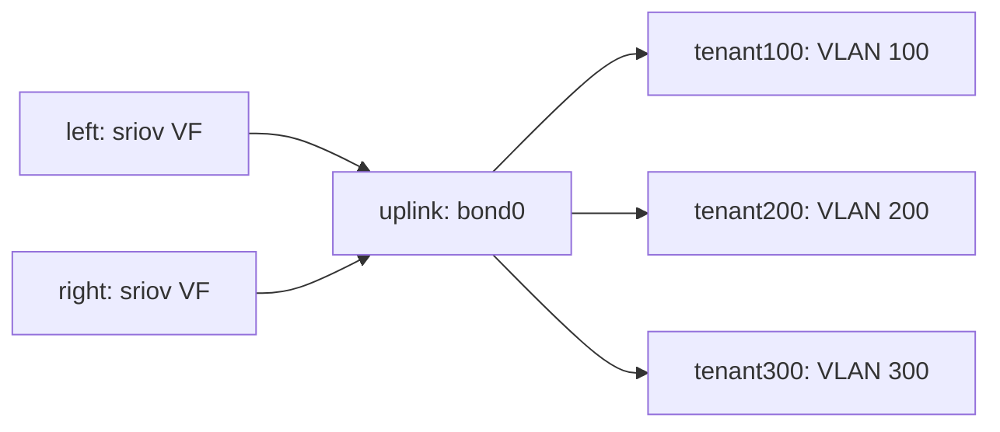

# NetworkTopology configuration

NetworkTopology is a **cluster-scoped administrator** DAG. Allocation steps select
DRA roots; Operation steps consume typed outputs from earlier dependencies. A
successful compile creates a NetworkTopologyRevision and a DeviceClass per root.
Users consume the resulting classes and do not supply plugin configuration.

## Steps and references

Each step has a unique `id`, `kind`, `pluginRef`, closed `config`, optional root
CEL `selectors` and operation `inputs`. A scalar input is `{from: step.port}`;
a repeated input is a list of those references. The compiler orders dependencies
rather than assuming YAML order alone. The POC accepts 1–32 steps and requires
allocation roots. Each root request must allocate exactly one device.

The [bond/VLAN example](../../examples/bond-vlan/topology.yaml) expresses:



For example, the bond input is:

```yaml
inputs:
  members:
  - {from: left.interface}
  - {from: right.interface}
config:
  ifName: bond0
  mtu: 1500
  up: true
  mode: active-backup
  monitorIntervalMs: 100
  failOverMac: active
```

A VLAN uses `parent: {from: uplink.interface}`. Operation steps allocate no
additional physical device; the complete DAG executes once for the claim.

## Configuration and composition validation

Compilation validates every plugin contract and config, unknown keys, dependency
references/cycles, input cardinality, type/link type, output exports, duplicate
interface names, effect templates and budget coverage. Ownership/access rules
reject incompatible use such as assigning one interface to two masters or using
an RDMA/VFIO output as an Ethernet parent. Node/runtime checks additionally
validate actual physical identities, capabilities, policy grants and current
native state. Compile-time validity does not prove that hardware is available.

Root CEL selectors **add** restrictions to the generated class's mandatory driver,
plugin, mode, link type and allocation-ready selection; they do not replace it.
For a dedicated PF's VFs:

```yaml
selectors:
- 'device.attributes["dra-multi-network.schseba.github.io"].pfPciAddress == "0000:29:00.0"'
```

Replace the PCI address with the approved secondary PF. Never select management
interfaces merely because they appear in inventory.

## Why effectBudget exists

`spec.effectBudget.allow` is an administrator's ceiling for this topology. It
lets compilation reject a plugin/chain that asks for operations outside the
reviewed design. A bond/VLAN topology permits moving/configuring links, creating
a bond, attaching members and creating VLANs; a plain VF topology permits only
move/configure. It is **not a hardware permission grant** and does not replace
DeviceExposurePolicy. A descriptor cannot add authority by listing an effect.
Native execution still requires the allocated resources, approved physical
scope and current ownership. Created sandbox objects derive authority from
validated inputs; hardware and shared host objects require explicit policy grants.

## Revisions and generated classes

```bash
kubectl apply -f examples/bond-vlan/topology.yaml
# Wait for this generation, then Ready, to avoid reading a previous revision.
generation=$(kubectl get networktopology dual-vf-bond-vlan -o jsonpath='{.metadata.generation}')
kubectl wait --for="jsonpath={.status.observedGeneration}=$generation" \
  networktopology/dual-vf-bond-vlan --timeout=120s
kubectl wait --for=condition=Ready networktopology/dual-vf-bond-vlan --timeout=120s
kubectl get networktopology dual-vf-bond-vlan -o yaml
```

`status.revisionRef` identifies the immutable snapshot; `status.rootClasses`
returns the exact root-to-DeviceClass mapping. Do not guess names or edit the
managed classes. Changing config/contract produces a different revision and
classes. Existing claims continue using their locked revision. If compilation
fails, `Ready=False` with a validation error; an old status reference is not
proof that the new generation is usable.

[Resource translation](resource-translation.md) explains this mapping in detail.
[Pod usage](../user/pods.md) shows how to request every root. Deleting the source
stops new consumers; retained revisions remain until claims and node journals
drain. See [operations](../operations.md).
