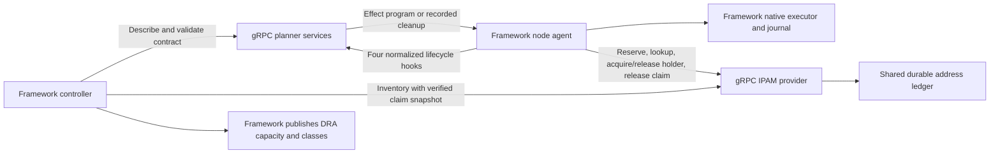

# Plugin ownership and the production gRPC boundary

Status: production design, with local IPAM provider interfaces implemented.
The POC runs network planners and the ConfigMap IPAM backend in the framework
processes. It has no external planner/provider server, protobuf API, RPC client,
or `GRPC` NetworkPlugin implementation. The deployment and configuration examples
below describe the proposed production contract; they cannot be applied to the
current CRDs. Use the [current examples](../examples/README.md) to test today.

## Three distinct call boundaries


| Boundary                     | Implemented today                                                                            | Production direction                                                      |
| ---------------------------- | -------------------------------------------------------------------------------------------- | ------------------------------------------------------------------------- |
| Kubelet to DRA driver        | Kubelet gRPC through `kubeletplugin`, including the second IPAM driver                       | Keep registration and allocation verification in the framework            |
| Framework to network planner | `networkplugins.Run(pluginapi.Request)` returns `pluginapi.Result` through a Go call         | An authenticated gRPC planner service for every network plugin family     |
| Framework to IPAM provider   | Direct calls through `[ipam.Provider](../pkg/ipam/provider.go)`, implemented by `ipam.Store` | A gRPC client implementing that interface, calling a durable IPAM service |


The migration includes host, SR-IOV, macvlan, ipvlan, bond, VLAN, accelerated
bridge, OVS, IPAM and address planners. An `EffectProgram` remains a declarative
framework template; it does not launch an independently deployed service.

The IPAM **planner** exports an opaque `AddressLease/v2`; it never reserves an
address. The address planner requests `linux/address-configure/v1` for its
granted interface and lease. The IPAM **provider** owns shared pool inventory,
concrete address reservations and attachment holders. It is a separate stateful
service contract, even if an owner packages both services in one release.




## Implemented IPAM interface and RPC mapping

The driver holds a `Provider` and a separate Kubernetes client. It verifies the
live claim UID, allocation fingerprint, class-origin configuration, one-device
request, consumed address capacity and node before constructing `ReserveRequest`.
The request contains plain identity/configuration values and approved node
labels, rather than a ResourceClaim or Node object. The agent uses the same
provider for pool inspection and attachment holders. The controller publisher
passes a verified claim-UID/fingerprint snapshot to `Inventory` and builds the
ResourceSlices itself. No caller receives the backend's client or raw ledger.


| Current interface method            | Proposed RPC         | Required behavior                                                                                                 |
| ----------------------------------- | -------------------- | ----------------------------------------------------------------------------------------------------------------- |
| `ListPools(ctx)`                    | `ListPools`          | Return pool metadata for node eligibility; this does not establish allocation readiness                           |
| `GetPool(ctx, name)`                | `GetPool`            | Return pool UID, config digest, approved fabric/node scope and total usable capacity                              |
| `Inventory(ctx, fingerprints)`      | `ReconcileInventory` | Reconcile against the controller's complete snapshot; fence orphan reservations and missing/corrupt backend state |
| `Reserve(ctx, ReserveRequest)`      | `ReserveAddress`     | Atomically reserve one address; replay the same allocation identity without changing its address                  |
| `Lookup(ctx, Lease)`                | `LookupReservation`  | Require the exact pool UID/config digest, allocation fingerprint, claim, request and share ID                     |
| `AcquireHolder(ctx, HolderRequest)` | `AcquireHolder`      | Idempotently bind one attachment incarnation before native address use; reject releasing/released reservations    |
| `ReleaseHolder(ctx, HolderRequest)` | `ReleaseHolder`      | Idempotently remove only that holder after verified cleanup                                                       |
| `Release(ctx, claimUID)`            | `ReleaseClaim`       | Fence new holders, and free reservations only after all holders are gone                                          |


`PoolInfo`, `ReserveRequest`, `HolderRequest` and `Lease` are serializable Go
values. Context carries cancellation/deadlines and is not serialized. This is
the implemented call boundary, not a finished wire protocol. The production
adapter still needs versioned protobuf messages, authentication/authorization,
response validation, bounded messages and explicit status/error mapping. Reserve
authorization must accept only verified framework callers; users must not be
able to claim an entitlement by sending these fields themselves. `Inventory`
requires controller authority, while holder mutations require the appropriate
node/attachment scope. Claim release must be authorized for that exact claim.

The local backend retains ConfigMap CAS, UID-pinned ledgers, pool overlap checks,
cleanup tombstones and orphan fencing. Admission still calls Store helpers for
administrator pool validation and deletion protection; the future management
API must preserve these checks when storage moves out of Kubernetes. Pool
creation/deletion and primary-range approval are administrator operations,
separate from ordinary planner hooks and workload reservation RPCs.

Moving a call across the network does not make scheduler allocation and address
reservation one transaction. The framework must validate returned identities and
addresses against the locked revision and grants before executing effects.
Capacity remains the fixed usable total, published once per subnet by the
leader-elected framework publisher. Backend replicas must share a transactional
ledger; they cannot each advertise or allocate an independent copy of the pool.

## What every network plugin owner builds

1. Define a closed `configSchema`, typed input/output ports, allowed effects and
  a versioned cleanup contract. Start with an `Operation` when consuming an
   existing interface. Allocation planners must preserve a certified native
   allocation profile; changing the transport does not permit arbitrary DRA
   drivers or new allocation authority. IPAM remains the certified exception
   for `ipam.schseba.github.io`.
2. Implement the four [planner hooks](../pkg/pluginapi/README.md) using normalized
  config and opaque references. Prepare/connect return deterministic effect
   programs. Remove/unprepare identify the original recorded hook/execution;
   they cannot discover fresh deletion targets. Ordinary planners need no
   Kubernetes credentials, host mounts, netlink, OVSDB or journal access. OVS
   effects still execute in the framework's native executor.
3. Package the handlers behind the future common gRPC SDK host. That host should
  handle envelope validation, authentication, compatibility negotiation,
   deadlines, health and error mapping; owners should not recreate that machinery
   per plugin. The existing SDK supplies Go request/result types and scope
   validation only: this repository does not yet ship that server host or proto.
4. Publish a container image pinned by digest, its descriptor, supported protocol
  and state versions, conformance results and deployment manifests. A new effect
   opcode also requires framework executor support, policy/budget validation and
   recovery tests. Listing an unknown opcode in a descriptor cannot implement it.
5. Deploy the service, then register its administrator-owned NetworkPlugin.
  The framework must authenticate a `Describe` handshake and check the exact
   descriptor digest, protocol/state versions and release identity against the
   operator-approved artifact. A service's self-reported digest alone is not
   proof of its image identity. Lock the accepted contract into revisions.
6. Wait for service/provider health, plugin acceptance, topology readiness and
  node capability checks before giving generated DeviceClass names to users.
   `Accepted` validates a contract; it is not proof that a backend is reachable
   from each node or that hardware has been approved.

The production request envelope should add an operation ID, execution scope,
contract digest, generation/coordinator fencing and a digest of the semantic
inputs to the existing request fields. Replays must retain those identities;
transport deadline changes must not produce a new allocation or holder. These
distributed fields and the `Describe` RPC are still to be implemented. Controller
compilation needs a reachable authenticated descriptor service or an approved
release bundle; offline compilation must validate against that bundle. A
node-local Unix socket alone cannot serve the controller's discovery needs.

## Example: a remote VLAN planner

This **proposed** descriptor uses the existing VLAN config, port and effect
vocabulary. `GRPC` and `implementation.endpoint` are new fields/values that need
API, admission, controller and node support before this example can run. Client
TLS credentials belong to administrator-managed framework configuration, not
Pod config; the controller and node agent both need authenticated service access.

```yaml
apiVersion: networking.dra-multi-network.schseba.github.io/v1alpha1
kind: NetworkPlugin
metadata: {name: site-vlan}
spec:
  implementation:
    type: GRPC
    name: site-vlan
    version: v1
    endpoint: dns:///site-vlan.network-plugins.svc.cluster.local:9443
  kind: Operation
  configSchema:
    type: object
    additionalProperties: false
    required: [ifName, mtu, up, vlanId]
    properties:
      ifName: {type: string, pattern: '^[A-Za-z0-9_.-]{1,15}$'}
      mtu: {type: integer, minimum: 576, maximum: 9000}
      up: {type: boolean}
      vlanId: {type: integer, minimum: 1, maximum: 4094}
  inputs:
    parent: {type: KernelInterface/v1, linkType: ethernet, minItems: 1, maxItems: 1, access: CreateChild}
  outputs:
    interface: {type: KernelInterface/v1, linkType: ethernet, minItems: 1, maxItems: 1, ownership: Created}
  allowedEffects: [linux/create-vlan/v1, linux/link-configure/v1]
  stateContract: {version: v1, cleanup: RecordedEffects}
```

The plugin owner supplies the image and its `serve`/`health` commands; these are
illustrative commands, not shipped binaries. This Deployment/Service template
runs a pure planner without host privileges. Supply a site namespace, real image
digest and server/probe TLS Secrets containing `tls.crt`, `tls.key` and `ca.crt`.
Use a probe client identity authorized only for health checks. The server must
require client certificates, authorize framework identities and expose the
standard gRPC health service. The example uses an authenticated exec probe for
mutual TLS; Kubernetes' native TLS probe mode does not verify server certificates.
See [Kubernetes probe behavior](https://kubernetes.io/docs/tasks/configure-pod-container/configure-liveness-readiness-startup-probes/#use-tls-with-grpc-probes).

```yaml
apiVersion: apps/v1
kind: Deployment
metadata: {name: site-vlan, namespace: network-plugins}
spec:
  replicas: 2
  selector: {matchLabels: {app: site-vlan}}
  template:
    metadata: {labels: {app: site-vlan}}
    spec:
      automountServiceAccountToken: false
      securityContext: {runAsNonRoot: true, runAsUser: 10001, fsGroup: 10001}
      containers:
      - name: planner
        image: registry.example.invalid/network/site-vlan:latest
        command: [/plugin]
        args: [serve, --listen=:9443, --tls-dir=/run/tls]
        ports: [{name: grpc, containerPort: 9443}]
        resources:
          requests: {cpu: 100m, memory: 64Mi}
          limits: {cpu: "1", memory: 256Mi}
        securityContext:
          allowPrivilegeEscalation: false
          readOnlyRootFilesystem: true
          capabilities: {drop: [ALL]}
          seccompProfile: {type: RuntimeDefault}
        readinessProbe:
          exec:
            command: [/plugin, health, --address=localhost:9443, --server-name=site-vlan.network-plugins.svc.cluster.local, --tls-dir=/run/probe-tls]
        volumeMounts:
        - {name: tls, mountPath: /run/tls, readOnly: true}
        - {name: probe-tls, mountPath: /run/probe-tls, readOnly: true}
      volumes:
      - name: tls
        secret: {secretName: site-vlan-tls, defaultMode: 0440}
      - name: probe-tls
        secret: {secretName: site-vlan-probe-tls, defaultMode: 0440}
---
apiVersion: v1
kind: Service
metadata: {name: site-vlan, namespace: network-plugins}
spec:
  selector: {app: site-vlan}
  ports: [{name: grpc, port: 9443, targetPort: grpc}]
```

The health command validates the service DNS name in the server certificate
while connecting to localhost. Load-test to size resources, add replica
spreading/disruption controls, and configure network
policy for the controller and node agents, including host-network callers. Make
cluster DNS/service routing available to host-network agents before selecting a
Service endpoint. Plugin TLS Secrets and framework client Secrets are distinct.

An existing topology can consume the planner with this **step fragment**:

```yaml
- id: tenant
  kind: Operation
  pluginRef: {name: site-vlan}
  inputs: {parent: {from: uplink.interface}}
  config: {ifName: tenant100, mtu: 1500, up: true, vlanId: 100}
```

The containing topology must supply `uplink.interface`, allow the two VLAN
effects in its budget, and have the appropriate physical policy grants. This
operation does not create an extra allocation class. See the current
[declarative VLAN example](../examples/effect-program/README.md) for a complete
working topology with the same ownership model.

## Example: remote IPAM planner and provider

The certified IPAM descriptor would preserve its existing allocation driver,
configuration and output contract while selecting a planner endpoint. This is a
**proposed migration** of the seeded descriptor, requiring certification and
compiler support; applying it today would fail builtin contract validation.

```yaml
apiVersion: networking.dra-multi-network.schseba.github.io/v1alpha1
kind: NetworkPlugin
metadata: {name: ipam}
spec:
  allocationDriver: ipam.schseba.github.io
  implementation:
    type: GRPC
    name: ipam
    version: v1
    endpoint: dns:///ipam-planner.network-plugins.svc.cluster.local:9443
  kind: Allocation
  configSchema:
    type: object
    additionalProperties: false
    required: [network, subnet]
    properties:
      network: {type: string}
      subnet: {type: string}
  outputs:
    lease: {type: AddressLease/v2, minItems: 1, maxItems: 1, ownership: Exclusive}
  allowedEffects: []
  stateContract: {version: v1, cleanup: RecordedEffects}
```

Deploy `ipam-planner` and `address-planner` using the pure-planner template with
their own approved images/descriptors. Migrate `address-cni` in the same way,
preserving its interface/lease inputs and address effect ceiling. Neither planner
gets database credentials. The provider endpoint is a separate administrator
setting on the framework, shared by its controller and nodes, not a field in
topology config or a planner's permission to reserve addresses. For example,
this **proposed framework configuration** selects that service:

```yaml
ipamProvider:
  endpoint: dns:///site-ipam.network-plugins.svc.cluster.local:9443
  serverName: site-ipam.network-plugins.svc.cluster.local
  tlsDirectory: /run/dra-multi-network/ipam-client-tls
```

This is not an existing Helm value, flag or config file. Production support must
create the RPC client from administrator-approved endpoints/credentials and
inject it wherever the POC currently injects `ipam.Store` as `ipam.Provider`.

For a provider backed by an external transactional database, adapt the Deployment
and Service template to `site-ipam`, replace the image with the owner's provider
image and supply its database credentials, for example this **container fragment**:

```yaml
name: provider
image: registry.example.invalid/network/site-ipam:latest
command: [/ipam-provider]
args: [serve, --listen=:9443, --tls-dir=/run/tls]
env:
- name: DATABASE_URL
  valueFrom:
    secretKeyRef: {name: site-ipam-database, key: url}
```

The owner implements approved pool provisioning, durable atomic uniqueness,
backup/restore, release tombstones, schema migration and holder reconciliation.
Every replica uses the same database. A ConfigMap-backed remote implementation
instead needs its own service account and narrowly scoped pool/ledger RBAC;
extend admission's backend identity allowlist before granting it ledger writes.
The provider's storage credentials are private to that service. Native effects,
node journals, DeviceClasses, ResourceSlices and kubelet DRA registration remain
framework-owned in both cases.

The [macvlan example](../examples/ipam/README.md) still requests one interface
class plus one address class in one ResourceClaim. The [two-VF example](../examples/ipam/two-vf/README.md)
still requests four roots: two VFs and two one-address IPAM shares. Remote transport
does not change these application manifests or create a class for the address
Operation. It replaces the call sites that provide the concrete leases.

## Production acceptance and upgrades

Use mutual TLS and authorize each method and pool/attachment scope. Rotate
credentials without dropping durable ownership. gRPC supports client certificate
authentication; application authorization is still required. See
[gRPC authentication](https://grpc.io/docs/guides/auth/).

Set bounded RPC deadlines and shutdown/drain behavior. An RPC timeout or
cancellation is not evidence that a backend mutation rolled back. Reconcile a
lost reply by replaying the same reservation/holder identity or querying its
durable outcome. Keep retry policy bounded and retry only operations whose
idempotency contract supports it. See [deadlines](https://grpc.io/docs/guides/deadlines/)
and [retry behavior](https://grpc.io/docs/guides/retry/).

Implement `grpc.health.v1` and meaningful readiness for contract compatibility
and, for providers, writable authoritative storage. Emit RPC latency/failures,
exhaustion, fenced pools and outstanding holders so operators can diagnose
capacity and cleanup. Health alone does not prove fabric reachability or lease
validity. See [gRPC health checking](https://grpc.io/docs/guides/health-checking/).

Owners must exercise malformed/out-of-scope results, concurrent reservations,
lost replies, delayed requests, backend outage, node/service restart, cleanup
failure and upgrades with active claims. Run the existing
[IPAM end-to-end suite](../test/integration/ipam/README.md) against the RPC adapter
as well as the local provider. Two replicas alone do not establish availability
or recovery correctness; test database failover and restoration without reusing
uncertain addresses. Preserve holders during outages and fail new attachment or
release work when durable ownership cannot be established.

Roll out a new immutable release/endpoint and descriptor version while retaining
old contracts until their revisions and claims drain. Do not replace an endpoint
with an incompatible cleanup implementation. Rollback must preserve ledger and
journal schemas and delayed-request fencing. Retire through normal retention,
not by deleting backend state or overriding finalizers. The POC's bounded
ConfigMap ledger, retained tombstones and released-claim-UID restriction still
need production storage/incarnation work; changing to gRPC does not remove those
limits or establish host-reboot and hardware recovery acceptance.