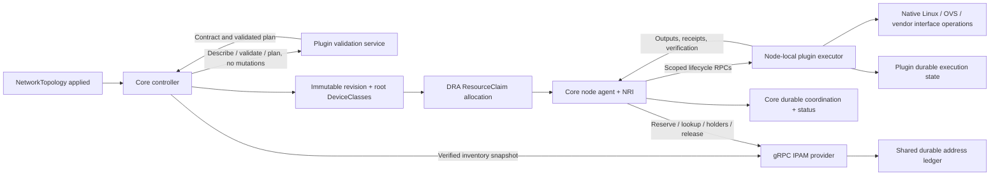

# Vendor plugins and the production gRPC boundary

Status: target design; external services and the execution protocol are not
implemented. This design replaces the earlier planner-only gRPC proposal.

The goal is for a vendor to add network validation, planning and native interface
operations by shipping and registering a plugin, without adding plugin-name
switches, Linux/OVS handlers or vendor-specific code to the core project. The core
coordinates Kubernetes DRA, policy, topology and runtime identity; plugins own
their network mechanisms and recorded native restoration.

The current POC uses internal pure planners in `pkg/networkplugins`, the native
executor in `pkg/effects`, and a local ConfigMap IPAM backend. It has no external
network/provider server, protobuf API, RPC client or `GRPC` NetworkPlugin
implementation. The stdlib-only `pluginapi.Request`/`Result` is a planning
contract, not a finished native-execution RPC contract. Current CRDs accept
`Builtin` and `EffectProgram` only. Examples below are proposals, not runnable
manifests. Use the [current examples](../examples/README.md) today.

## Ownership and the three boundaries

| Boundary | Current POC | Target |
|---|---|---|
| Kubelet → DRA driver | gRPC through `kubeletplugin`, including IPAM | Core retains driver registration and allocation verification |
| Core → network plugin | Go planners return effects; core executes them | gRPC plugin validates/plans and its node-local executor performs native operations |
| Core → IPAM provider | `ipam.Provider` calls local `ipam.Store` | Separate gRPC service owns shared durable reservations and holders |

| Owner | Target responsibility |
|---|---|
| Core controller | Descriptor acceptance, generic schema/port/DAG validation, locked revisions, root DeviceClasses and retention |
| Core node agent | Inventory/publication, allocation and physical ownership, grant intersection, DRA/NRI coordination, attachment identity, durable execution coordination and status |
| Network plugin | Plugin-specific config/plan validation, native Linux/OVS/vendor operations on the authorized node, before-images, idempotent replay, native verification and restoration |
| IPAM provider | Pool inventory, concrete reservations, attachment holders, durable uniqueness and release fencing |

Core policy and ownership do not move into plugins. Privileged node executors are
operator-approved trusted components: a descriptor or signed grant alone cannot
sandbox arbitrary host-privileged code. Operators restrict mounts, credentials,
namespace access and capabilities to the selected execution profile. Validation
services need no host access. Execution services must not receive a broad
Kubernetes client or the IPAM provider's storage credentials by default.



## Two phases: compilation and execution

1. **Topology apply:** the controller accepts an operator-approved descriptor,
   validates the closed configuration schema, typed ports, graph and budgets,
   invokes plugin-specific validation/planning, and locks the accepted contract,
   normalized config, plan identity and execution order into a revision. It
   publishes a DeviceClass per Allocation root. These calls never mutate host
   or Pod interfaces. Today `Compile` already calls `PlanPrepare` and
   `PlanConnect` to check generated programs in process.
2. **Allocated Pod:** the core checks the claim, complete root coverage, saved
   revision, live physical identity and grants. It coordinates the plugin's
   runtime hooks on the node that owns the resources. The plugin performs its
   native work and reports durable outcomes and typed outputs. NRI must verify
   required attachment completion before consuming containers start.

`Describe`, validation and plan RPC names/messages still need specification.
Controller-accessible validation and node-local execution may be packaged in
one vendor release, but must have compatible locked contract/release identities.
A controller cannot use an arbitrary node's namespace to execute a workload.

| Lifecycle hook | Target plugin behavior |
|---|---|
| `NodePrepare` | Execute authorized hardware preparation and persist original/applied state |
| `ConnectNetwork` | Create/configure the authorized sandbox and host network objects in DAG order |
| `RemoveNetwork` | Verify and restore the saved connection execution in reverse order |
| `NodeUnprepare` | Verify and restore the saved preparation execution; acknowledge retirement |

Keep these lifecycle names and semantics. Their future execution requests/results
must extend or replace today's pure planner envelopes; a transport adapter alone
cannot turn `pluginapi.Result.Program` into a native-execution acknowledgement.
Cleanup identifies an original recorded execution, never fresh deletion targets.

## Adding vendor behavior without core handlers

A vendor ships a pinned plugin image, closed config schema, typed port contract,
versioned action identifiers, cleanup/state contract and conformance results.
The administrator deploys and registers it, grants its declared actions through
policy/topology budgets, and composes its ports into a topology. The core uses
generic descriptor validation, RPC dispatch, grants and receipts. The vendor's
node executor implements its own native actions; the core does not interpret
vendor payloads or need a matching `pkg/effects` opcode handler.

For example, a vendor can declare `vendor.example/port-configure/v1` and supply
its implementation and restoration logic in its plugin. The target must validate
this identifier, plugin/descriptor binding, schema and granted scope generically.
Declaring an identifier is not permission to execute it: the administrator must
approve it, and the core must intersect descriptor permissions, topology budget,
physical policy and live ownership before dispatch. A new effect opcode must
not require a vendor-specific core patch in this target design.

This requires removing plugin-name dispatch and built-in-only opcode/schema
assumptions from the production compilation/execution path. They still exist in
the POC; arbitrary external plugins cannot be registered today. An `EffectProgram`
is currently a declarative core template and does not launch an external process.
Migration must retain cleanup compatibility for saved POC executions until drain.

Vendor extensibility stays within negotiated port, allocation and grant profiles.
A network Operation can consume existing authorized interfaces without gaining
new discovery/allocation authority. New device allocation profiles, port kinds or
privilege models need a versioned generic capability contract and review; they
must not silently bypass DRA ownership. IPAM remains a separate allocation driver
and provider contract, not a network executor's entitlement to reserve addresses.

## Compatibility ownership for third-party plugins

The core remains authoritative for physical compatibility and DRA publication.
A plugin declares its requirements, not arbitrary ResourceSlices, counter-set
names, device identities or extra capacity. The current node publisher derives
these groups in [inventory.go](../pkg/multinetwork/inventory.go) from discovered
PCI/parent-PF identity and the approved profile; internal planners do not supply
them. The future generic descriptor replaces plugin-name-based classification.

| Information | Target owner |
|---|---|
| Actual device PCI identity, parent PF and protected devices | Core discovery |
| Required ownership/access, compatibility mode and mutation scope | Versioned plugin descriptor |
| Approved modes, native privileges, action permissions and capacity bounds | Administrator policy and accepted capability profile |
| Physical interface/family domains, groups, shared accounting and ResourceSlices | Core node publisher |
| Authorized native changes, durable verification and restoration | Node-local plugin executor |

Descriptor semantics must cover exclusive function handoff versus shared-parent
use, the relevant granted interface/PF scope, a versioned compatibility mode,
child-capacity requirements and native mutation permissions. Core validates the
accepted declaration against policy, topology, certified allocation/port profiles
and discovered hardware, then binds it to actual physical identities. Operation
plugins consume existing granted references; declarations do not create new
allocation authority or double-charge allocation roots.

A plugin cannot select another counter domain to hide a conflict or advertise a
second copy of a parent's capacity. Equivalent profiles from multiple vendors
must participate in one authoritative accounting model. Cross-vendor sharing needs
an agreed versioned compatibility contract, not simply equal self-selected strings.
Unknown modes fail closed until their semantics and grants are operator-approved;
new capabilities use a reviewed generic protocol rather than vendor-specific core
handlers. Privileged plugin behavior still requires trust and conformance: valid
declarations alone cannot prove native code respects its scope.

### Six existing profiles

For standard kernel handoff and shared macvlan/ipvlan profiles, the current mapping
below is the reference behavior to preserve in the generic implementation:

| Profile | Interface domain | Interface group | PF-family group |
|---|---|---|---|
| Exclusive host PF | PF PCI identity | `kernel-handoff` | `pf-handoff` |
| Exclusive SR-IOV VF | VF PCI identity | `kernel-handoff` | `host-retained` |
| macvlan on PF | PF PCI identity | `macvlan` | `host-retained` |
| ipvlan on PF | PF PCI identity | `ipvlan` | `host-retained` |
| macvlan on VF | VF PCI identity | `macvlan` | `host-retained` |
| ipvlan on VF | VF PCI identity | `ipvlan` | `host-retained` |

All members of a PF family share the family domain derived from that PF identity.
Each physical function has its own interface domain. Core emits group identifiers
on `device.consumesCounters[]`; devices sharing a counter set must have a common
compatibility group, and ordinary allocation/capacity limits still apply.

- Exclusive PF handoff conflicts with every listed VF/shared profile in its family.
- Exclusive VF handoff conflicts with shared children on that same VF, but can
  coexist with shared children on its PF or another VF.
- macvlan and ipvlan conflict on the same parent interface. Multiple children of
  one compatible mode can coexist within approved shared capacity.
- Shared PF children and shared VF children can coexist, including different
  modes, because they use different interface domains and retain the same family
  mode. Different VFs likewise have independent interface domains.

This is allocation compatibility, not permission to mutate any interface. Core
must separately intersect action permissions, ownership and saved runtime grants
before dispatch, and retain ownership through uncertain native cleanup. A plugin
may only mutate the scope granted to its execution. Shared-parent grants must not
permit an executor to reconfigure the parent in a way that disrupts other holders.

The Kubernetes feature is
[`DRADeviceCompatibilityGroups`](https://kubernetes.io/docs/concepts/resource-management/dynamic-resource-allocation/dra-features/#device-compatibility-groups),
alpha since v1.37 and disabled by default. It requires `DRAPartitionableDevices`;
follow the [installation gate requirements](installation.md). The scheduler uses
published domains/groups; core node checks still enforce live ownership. Require
all six profiles and cross-vendor equivalents in conformance, including same-parent
rejection, different-parent sharing, duplicate capacity and retained cleanup.

## Durable execution and recovery contract

Before dispatch, the core records an operation identity and authorization scope.
Each execution binds the descriptor/release digest, saved revision, hook, step,
claim UID/allocation fingerprint, node UID/boot ID, Pod UID/sandbox incarnation,
semantic input digest and coordinator fencing generation. Retries keep that
identity; deadlines are not new operations. Returned outputs/receipts must match
it and the granted port/resource identities.

The plugin records intent and original state durably before mutation, then saves
applied state and a durable outcome. The core journal stores dispatch/receipt,
attachment and ownership coordination; plugin state stores native before-images
and restoration progress. Neither side may infer success from the other side's
process being alive. The protocol needs replay/query of an existing execution,
reconciliation after lost acknowledgements, and fencing of delayed requests.
Exact messages, storage APIs and namespace delegation remain implementation work.

An RPC timeout may follow a committed mutation. Query or replay the same identity;
do not create another network object or free ownership on uncertainty. Failed
connection compensates completed steps in reverse order through their owning
plugins. Cleanup checks original resource identity and expected applied state,
retains ownership on foreign state, and acknowledges success only after native
restoration is durably verified. Core retention cannot release or republish
uncertain resources. Editing/deleting live CRs never changes saved cleanup targets.

Node-local namespace/resource delegation must bind the validated sandbox and node
incarnation. Do not trust workload-supplied namespace paths or send raw file
descriptors as protobuf fields. Specify a scoped local capability/access mechanism
and least-privilege execution profiles before implementing the executor adapter.
Plugins cannot choose arbitrary additional devices or host deletion targets.
Core checks returned output scope and readiness; native state verification belongs
to the executor and generic conformance checks, not new vendor-specific core code.

Upgrade support must retain the matching executor and durable state decoder for
active executions. An incompatible replacement must fail closed; drain or use
explicit state migration. Plugin restart, node reboot and core restart must each
have tested replay/restoration behavior. No complete reboot guarantee exists today.

## Implemented IPAM interface and RPC mapping

The driver holds a `Provider` and a separate Kubernetes client. It verifies the
live claim UID, allocation fingerprint, class-origin configuration, one-device
request, consumed address capacity and node before constructing `ReserveRequest`.
The request contains plain identity/configuration values and approved node
labels, rather than a ResourceClaim or Node object. The agent uses the same
provider for pool inspection and attachment holders. The controller publisher
passes a verified claim-UID/fingerprint snapshot to `Inventory` and builds the
ResourceSlices itself. No caller receives the backend's client or raw ledger.


| Current interface method            | Proposed RPC         | Required behavior                                                                                                 |
| ----------------------------------- | -------------------- | ----------------------------------------------------------------------------------------------------------------- |
| `ListPools(ctx)`                    | `ListPools`          | Return pool metadata for node eligibility; this does not establish allocation readiness                           |
| `GetPool(ctx, name)`                | `GetPool`            | Return pool UID, config digest, approved fabric/node scope and total usable capacity                              |
| `Inventory(ctx, fingerprints)`      | `ReconcileInventory` | Reconcile against the controller's complete snapshot; fence orphan reservations and missing/corrupt backend state |
| `Reserve(ctx, ReserveRequest)`      | `ReserveAddress`     | Atomically reserve one address; replay the same allocation identity without changing its address                  |
| `Lookup(ctx, Lease)`                | `LookupReservation`  | Require the exact pool UID/config digest, allocation fingerprint, claim, request and share ID                     |
| `AcquireHolder(ctx, HolderRequest)` | `AcquireHolder`      | Idempotently bind one attachment incarnation before native address use; reject releasing/released reservations    |
| `ReleaseHolder(ctx, HolderRequest)` | `ReleaseHolder`      | Idempotently remove only that holder after verified cleanup                                                       |
| `Release(ctx, claimUID)`            | `ReleaseClaim`       | Fence new holders, and free reservations only after all holders are gone                                          |


`PoolInfo`, `ReserveRequest`, `HolderRequest` and `Lease` are serializable Go
values. Context carries cancellation/deadlines and is not serialized. This is
the implemented call boundary, not a finished wire protocol. The production
adapter still needs versioned protobuf messages, authentication/authorization,
response validation, bounded messages and explicit status/error mapping. Reserve
authorization must accept only verified framework callers; users must not be
able to claim an entitlement by sending these fields themselves. `Inventory`
requires controller authority, while holder mutations require the appropriate
node/attachment scope. Claim release must be authorized for that exact claim.

The local backend retains ConfigMap CAS, UID-pinned ledgers, pool overlap checks,
cleanup tombstones and orphan fencing. Admission still calls Store helpers for
administrator pool validation and deletion protection; the future management
API must preserve these checks when storage moves out of Kubernetes. Pool
creation/deletion and primary-range approval are administrator operations,
separate from ordinary planner hooks and workload reservation RPCs.

Moving a call across the network does not make scheduler allocation and address
reservation one transaction. The framework must validate returned identities and
addresses against the locked revision and grants before authorizing native address use by the node plugin.
Capacity remains the fixed usable total, published once per subnet by the
leader-elected framework publisher. Backend replicas must share a transactional
ledger; they cannot each advertise or allocate an independent copy of the pool.

## Deployment and registration

Separate control-plane validation from node-local execution reachability:

| Service | Placement and access |
|---|---|
| Validation / descriptor service | Controller-accessible Deployment or an approved offline release bundle; no native host mutations |
| Network executor | DaemonSet or node-local service on eligible nodes; authenticated local endpoint and only the operator-approved native privileges/state mounts |
| IPAM provider | Cluster service with a shared transactional ledger, independent from network execution |

A load-balanced Service must not route native interface execution to a different
node. Node endpoint resolution, readiness and capability publication must identify
the executor on the allocated node and match the locked descriptor/release.
Validation services may be replicated; executor state is scoped to its node and
saved executions. IPAM replicas must use one authoritative durable backend.

This **proposed** registration illustrates separate validation/execution endpoints.
`GRPC`, `validationEndpoint` and `nodeEndpoint` are not accepted current fields;
endpoint discovery, authentication and API naming still need implementation.

```yaml
apiVersion: networking.dra-multi-network.schseba.github.io/v1alpha1
kind: NetworkPlugin
metadata: {name: site-vlan}
spec:
  implementation:
    type: GRPC
    name: site-vlan
    version: v1
    validationEndpoint: dns:///site-vlan.network-plugins.svc.cluster.local:9443
    nodeEndpoint: unix:///run/dra-network-plugins/site-vlan.sock
  kind: Operation
  configSchema:
    type: object
    additionalProperties: false
    required: [ifName, mtu, up, vlanId]
    properties:
      ifName: {type: string, pattern: '^[A-Za-z0-9_.-]{1,15}$'}
      mtu: {type: integer, minimum: 576, maximum: 9000}
      up: {type: boolean}
      vlanId: {type: integer, minimum: 1, maximum: 4094}
  inputs:
    parent: {type: KernelInterface/v1, linkType: ethernet, minItems: 1, maxItems: 1, access: CreateChild}
  outputs:
    interface: {type: KernelInterface/v1, linkType: ethernet, minItems: 1, maxItems: 1, ownership: Created}
  allowedEffects: [linux/create-vlan/v1, linux/link-configure/v1]
  stateContract: {version: v1, cleanup: RecordedEffects}
```

The executor implements VLAN creation/link configuration and owns recorded native
restoration. Its validation service returns the matching approved contract and
checks configuration without creating interfaces. The core authenticates the
contract against the operator-approved release; a self-reported digest alone is
not proof of image identity. Credentials and execution privileges are operator
settings, not workload configuration. Existing claims keep their locked release.

An existing topology consumes the plugin using this **step fragment**:

```yaml
- id: tenant
  kind: Operation
  pluginRef: {name: site-vlan}
  inputs: {parent: {from: uplink.interface}}
  config: {ifName: tenant100, mtu: 1500, up: true, vlanId: 100}
```

The containing topology supplies `uplink.interface`, budgets the declared actions
and uses approved physical grants. This Operation creates no extra allocation
class. See the working [declarative VLAN example](../examples/effect-program/README.md)
for today's composition; its native execution still runs in the core.

## IPAM deployment remains separate

Migrate `ipam.Provider` to an authenticated gRPC client and a durable service;
keep Kubernetes entitlement verification and DRA publication with core callers.
The `ipam` plugin exports the provider-issued lease reference. The node-local
`address-cni` executor consumes that verified lease and interface to apply/remove
native addresses; it does not gain provider reservation or storage credentials.
Only the framework's authorized provider calls reserve/release addresses and
acquire/release attachment holders. Release a holder only after the address
executor's native cleanup is durably verified; fence uncertain outcomes.

The provider owner supplies pool administration, atomic uniqueness, backup/restore,
release tombstones, schema migration and holder reconciliation. Replicas share a
transactional ledger. ConfigMap-backed services need narrowly scoped ledger RBAC
and admission integration. Provider storage credentials stay private to it.
The [macvlan](../examples/ipam/README.md) and [two-VF](../examples/ipam/two-vf/README.md)
claims retain their interface/address roots; transport changes do not create a
DeviceClass for an address Operation.

## Production acceptance and upgrades

The common SDK/host must provide version negotiation, envelope validation,
authentication/authorization, bounded messages/deadlines, health, error mapping
and durable replay/query semantics. Health must include compatible saved-state
handling and node-local execution readiness, not only a listening socket. Use
[gRPC authentication](https://grpc.io/docs/guides/auth/),
[deadline](https://grpc.io/docs/guides/deadlines/),
[retry](https://grpc.io/docs/guides/retry/) and
[health](https://grpc.io/docs/guides/health-checking/) mechanisms with explicit
application-level authorization and idempotency contracts.

Conformance must exercise plugin-specific native actions without a core handler:
a vendor Operation with a new namespaced action should register, compile, execute,
verify, compensate and clean up solely through generic core mechanisms. Also test
out-of-scope inputs/outputs, management-device protection, concurrent ownership,
lost committed replies, replay, foreign native state, plugin/core restart, node
reboot, executor unavailability, delayed requests and upgrades with active claims.
Before-image restoration and retention must survive failure of either process.

For IPAM, run the [end-to-end suite](../test/integration/ipam/README.md) against the
remote provider and node address executor, including exhaustion, uniqueness,
holder cleanup and backend failover. Preserve holders during outages; do not
reuse uncertain addresses. Capacity allocation and reservations remain separate
accounting layers, not a distributed transaction.

Pin new releases/descriptors and retain old execution/state contracts until claims
and cleanup drain. Retire through normal retention, not state deletion or finalizer
overrides. The POC's ConfigMap limits and incomplete physical/reboot acceptance
remain; changing execution location does not establish production readiness.
