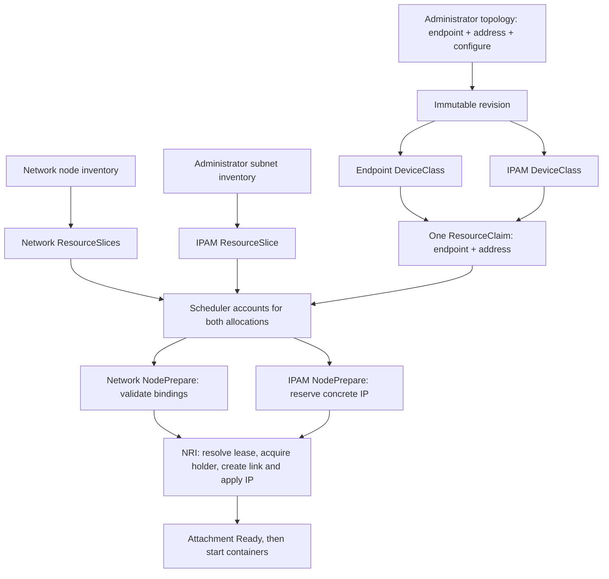

# IPAM with DRA subnet capacity

Status: implemented POC extension, 2026-10-12. This design records the scope
agreed before implementation. The [example](../examples/ipam/README.md) contains
runnable administrator and workload manifests, including a two-VF/two-IP case.

The implementation adds a second allocation root to a network topology: an IPAM subnet. One
ResourceClaim requests the interface root and one address-capacity unit from
the subnet root. Kubernetes accounts for both resources before the Pod runs;
the IPAM backend assigns the concrete address and the network framework applies
it to the secondary interface before allowing containers to start.

The example allocates **one IPv4 address per topology instance from an existing
subnet**. A topology instance is represented by one claim. Reusing the topology
definition in another Pod creates another claim and address. The address belongs
to an explicit address allocation root, rather than being added automatically
for every interface-producing step: configure the final
interface selected by the DAG. The two-VF example declares two address roots
and consumes two IPs in the same claim.

## Basis in the blog and current code

The companion blog sources are in `../sebasblog-blog/content/docs/`:

| Document | Relevant existing design |
|---|---|
| `dra-chainable-networking-proposal/index.md`, sections 8.5, 9 and 10 | IPAM produces `AddressLease/v2`; mixed-driver claims are allowed; stable reservations and attachment holders are separate. Section 8.5 explicitly leaves external IPAM capacity outside scheduling. |
| `dra-network-device-discovery-design/index.md` | A shared device advertises local consumable capacity; allocations receive share IDs. |
| `dra-network-framework-plugin-sdk/index.md` | Allocation roots, typed ports and four lifecycle hooks; the initial examples provide L2 only. |
| `dra-networking-mvp-implementation/index.md` | The MVP excludes IPAM and retained identities. |

This implementation extends that design by making subnet capacity scheduler-visible.
It keeps the reservation/holder split but initially uses claim identity, without
retained workload identities or migration.

The controller generates a DeviceClass per Allocation step in
[`pkg/controller/topology.go`](../pkg/controller/topology.go), with an IPAM
selection/configuration path for address roots. Admission checks all roots and
explicit address capacity in [`pkg/admission/server.go`](../pkg/admission/server.go).
[`pkg/multinetwork/agent.go`](../pkg/multinetwork/agent.go) validates declared
foreign IPAM dependencies while preparing only the networking driver’s devices.

## Allocation model

Use a separate DRA backend named `ipam.schseba.github.io`. Keep the existing
network driver responsible for interfaces, the DAG, NRI and native effects.
The IPAM backend owns subnet inventory and the authoritative address ledger.
Both drivers participate in the **same** ResourceClaim.

| Root | Allocating driver | Allocated resource | Capacity per claim |
|---|---|---|---|
| `endpoint` | `dra-multi-network.schseba.github.io` | Existing macvlan parent persona | `children: 1` |
| `address` | `ipam.schseba.github.io` | One shared subnet device | `addresses: 1` |

The example uses macvlan so interface scarcity cannot mask IPAM exhaustion.
The two-VF example pairs two address roots with two existing SR-IOV roots.

### Subnet inventory and capacity

An administrator assigns a dedicated secondary fabric a subnet and an allowed
node set. The backend publishes one canonical device per subnet, reachable on
that node set through `spec.nodeSelector`. Do not publish a copy of its entire
capacity in every node pool; that would multiply the address budget.

For `192.0.2.0/29`, reserve `.0` as the network address, `.7` as broadcast and
`.1` as the gateway. The usable range is `.2` through `.6`: **five addresses**.
Publish `allowMultipleAllocations: true`, capacity
`ipam.schseba.github.io/addresses: "5"`, and a request policy with default and
valid values equal to `"1"`. Require an explicit one-unit request in admission;
repeat the check against `consumedCapacity` during preparation.

Published capacity is the fixed usable total. Do not decrement it as backend
leases appear: the scheduler already subtracts allocated claim consumption.
Unprepared allocated claims also consume capacity. This follows the native
[v1.37 DeviceCapacity contract](https://github.com/kubernetes/api/blob/v0.37.0/resource/v1/types.go).
The design needs [DRA consumable capacity](https://kubernetes.io/docs/concepts/resource-management/dynamic-resource-allocation/dra-features/#consumable-capacity),
alongside the networking feature gates already required by the repo.

The subnet range is exclusively managed by this backend. External DHCP, manual
allocations and other IPAM systems must not allocate from the same range.
Pool configuration is immutable; the gateway and IPv4 network/broadcast
addresses are excluded from the usable range.
Drain before changing them. Backend corruption or unresolved orphan use fences
new allocations; it must never make an uncertain address appear free.

### DeviceClasses and trusted bindings

The topology controller continues to generate **two revision-owned classes**,
reported as `endpoint` and `address` in `status.rootClasses`. Application users
get those names; they do not configure either backend.

The API includes an optional `NetworkPlugin.spec.allocationDriver` for the certified
IPAM Allocation plugin. Omission preserves the existing network driver.
The framework accepts only that builtin IPAM contract; this is not a general
external-driver plugin facility. The IPAM plugin exports `AddressLease/v2`
instead of a kernel interface and has no Linux effects.

The endpoint class retains its existing selectors. The address class selects
the IPAM driver, a shared ready subnet device, and the administrator-approved
network and CIDR. It must not require PCI, interface mode or link type.

Each class has the existing class-origin `TopologyRootConfiguration`, addressed
to the network framework, pinning revision UID/digest, root and plugin digest.
The address class additionally has class-origin `IPAMAllocationConfiguration`
addressed to the IPAM backend, pinning network, subnet and one-address profile.
These are opaque configurations inside DeviceClass, not new CRDs.

Resolve configuration with request applicability and preserve `FromClass`.
The network framework may inspect the foreign allocation only to validate its
explicitly declared dependency and obtain a lease handle. It must not prepare
the foreign device, return it as its own kubelet result, or consume unrelated
drivers' allocations. The IPAM driver ignores the network configuration.

The example pins a single fabric through the endpoint's approved PF selector
and the IPAM subnet's approved nodes. Admission/controller validation must verify
that this PF is connected to that fabric. Broader multi-fabric selection can
later publish a common qualified `networkID` attribute on both devices and use
`matchAttribute`; the example does not need that inventory extension.

## Concrete address backend

The demo uses existing Kubernetes clients and optimistic concurrency;
no new database, external IPAM dependency or public lease CRD is required.
An immutable administrator ConfigMap holds pool settings. A separate,
backend-owned ConfigMap per pool holds a versioned lease ledger, protected by
RBAC and a finalizer while reservations/holders remain. The controller creates that ledger once
before publishing inventory and pins its API UID in the pool annotation. Missing existing ledger state must quarantine the
pool, never recreate it as empty.

Every allocation/release updates the ledger with `resourceVersion` compare-and-
swap. On conflict, reread and retry. Address availability, reservation identity,
state transition and holder changes must be committed atomically. An in-memory
map or independent per-node journal cannot provide cross-node uniqueness.

Key a reservation by claim UID, request, driver, pool, device and share ID; save
the pool UID/config digest and allocation fingerprint as well. Replaying that
identity returns the existing address. A recreated claim with the same name
has a different UID and does not inherit it.

An attachment holder additionally identifies Pod UID, sandbox, node UID, boot
ID, revision digest and connection incarnation. The framework journals its
idempotency key before acquiring a holder, then saves the returned receipt.
The backend must reconcile a lost acknowledgement using that key.

For this small pool, a single ledger is sufficient. Its explicit limit is
a 240 KiB ledger bound and whole-pool write contention; shard or move to a transactional
backend before supporting large pools. Reject state beyond the configured size
bound before mutation. Cleanup tombstones fence delayed operations. The demo retains them until the
pool is drained and deleted; continuous long-term use needs safe tombstone GC.

Keep Kubernetes and ledger operations in framework/backend code. The existing
stdlib-only plugin SDK receives opaque references and plans effects; planners
do not receive clients or reserve addresses themselves.

## Lifecycle and failure behavior

1. **Schedule:** one claim requests every topology root, exactly one device each.
   If subnet capacity is exhausted, the Pod stays Pending before any new runtime
   attachment is created. Scheduler allocation is not a distributed transaction
   with the concrete-address backend; preparation still validates availability.
2. **Prepare:** each driver verifies the claim UID, class-origin config and its
   own result. IPAM requires a nonempty share ID and exactly one consumed address
   unit, then atomically reserves an address. Network preparation checks complete
   bindings, including the expected IPAM result, but does not wait for its lease.
   Kubelet may invoke the two drivers in either order or concurrently.
3. **Connect:** after preparation succeeds, the network framework obtains the
   authoritative reservation, validates its full identity/network/CIDR, and
   acquires the attachment holder before applying the address. The address
   operation consumes `endpoint.interface` and `address.lease`. Read back the
   assigned address before marking Ready. Missing leases, backend outages and
   identity mismatch fail before container start; there is no automatic fallback.
4. **Remove:** restore the recorded address effect before removing the macvlan
   interface. Drop the holder only when address use has ended and cleanup has
   been verified. Preserve the holder/receipt on uncertain or failed removal.
5. **Unprepare:** IPAM atomically moves the reservation into a releasing state
   that rejects new holders, and frees it only once all holders are gone.
   If called before network cleanup, return a retryable error. No driver ordering
   assumption is allowed. Network unprepare retains its existing recovery rules.
6. **Claim release:** Kubernetes releases its capacity accounting according to
   claim lifetime. A manually managed claim retains its allocation after Pod
   deletion. Never promise that deleting the Pod alone restores DRA capacity.

Protect holder acquisition against concurrent unprepare with the same backend
transaction/state check. Released incarnations cannot be reopened by delayed
prepare/connect calls. If sandbox connection fails, compensate owned effects
and release only its holder; keep the claim reservation for a safe retry.

The backend ledger remains authoritative for concrete uniqueness even if claim
capacity has been released before orphan cleanup completes. Such mismatch fences
new pool allocations until reconciliation; never reuse an address merely because
the Pod/claim API object was deleted. Restart or node loss cannot expire active
holders on a timer. Existing attachments remain configured during a backend
outage, but new attachment and release work requires durable backend evidence.

Report addresses in NetworkAttachmentStatus. ResourceClaim allocation results
record subnet identity, share ID and capacity; this demo does not write optional
ResourceClaim device status. Status is an observation; connect and cleanup use
the protected ledger and saved receipts. A released IPAM claim UID is fenced;
recreate manually managed claims for new instances after unprepare. Supporting
reuse of one allocated claim requires explicit preparation-incarnation fencing.

## Implementation and checks

The existing controller hosts `pkg/ipam.Publisher` under leader election. The
existing node process registers a second kubelet DRA plugin with the IPAM driver
name. Both use `pkg/ipam.Store`; no additional binary or deployment is needed.
`pkg/topology/ipam.go` supplies the two certified descriptors, and
`pkg/effects/address.go` applies/restores only the address named by the granted
lease on an owned private sandbox interface.

The API additions are `NetworkPlugin.spec.allocationDriver` and attachment
output `ips`. Generated deepcopy and CRD schemas are updated in both locations.
Helm gives the controller ResourceSlice publication and ServiceCIDR inspection;
ConfigMap access is confined to the driver namespace. A separate webhook entry
protects IPAM configuration and backend ledgers in that namespace.

Tests cover concurrent CAS reservations, exact capacity, replay and released
incarnation fencing, lost-response cleanup, missing-ledger quarantine, primary
range validation, class publication, missing/forged claim roots, duplicate lease
consumers, SDK serialization and private-interface address grants. The
[integration suite](../test/integration/ipam/README.md) checks five unique IPs,
secondary traffic, sixth-claim exhaustion, cleanup/reuse, same-boot restart and
two-VF/two-IP allocation. Acceptance results belong in [validation](validation.md).

## Scope left out of the first example

No whole-CIDR allocation, DHCP, DNS integration, new default routes,
IPv6/dual-stack, persistent workload identities, live migration, external IPAM
adapters or configurable allocation sizes. Address capacity counts host IPs;
it does not guarantee an aligned, contiguous subnet block. The kernel's
connected route comes from the assigned prefix;
the primary CNI's default route remains in place. The gateway is reserved but is
not automatically installed as a default route. Physical fabric configuration
is an administrator prerequisite, as in the existing examples.
